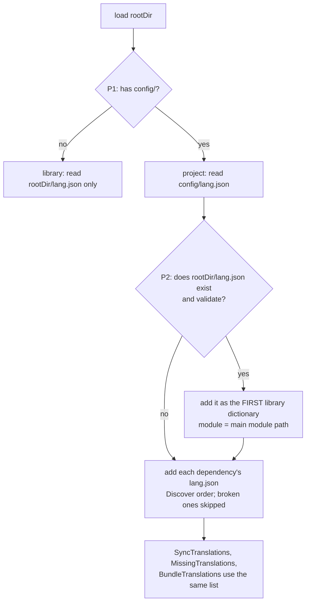

# Which dictionaries a project reads

A "project" is a module with a `config/` directory; its own dictionary is `config/lang.json`.
A library module that ships its own demo is **both**: it has `config/` (the demo) and a root
`lang.json` (the library dictionary its consumers read). Every diamond has an id;
[`docs/PLAN.md`](../PLAN.md) §3 maps each branch to its test.

Precedence for a key and language (unchanged rule, now with the main module's library file):
`config/lang.json` value if non-empty → main module `lang.json` → dependencies in Discover order.
